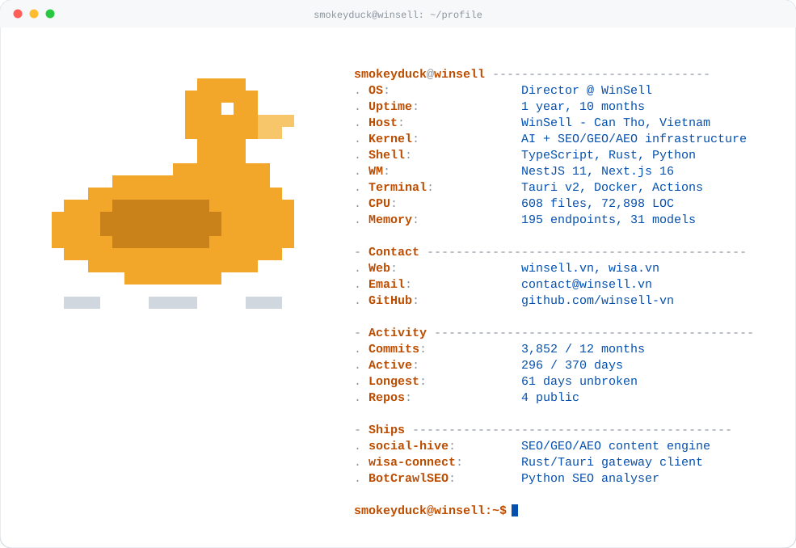

  <picture>
    <source media="(prefers-color-scheme: dark)" srcset="./assets/neofetch-dark.svg" />
    
  </picture>

### shipped

**[`social-hive`](https://github.com/winsell-vn/social-hive)** — SEO/GEO/AEO social content engine.
NestJS, Next.js, Prisma, MySQL, Redis.

**[`wisa-connect`](https://github.com/winsell-vn/wisa-connect)** — desktop client for the WISA gateway.
Rust, Tauri v2, TypeScript.

**[`BotCrawlSEO`](../../../BotCrawlSEO)** — Python SEO analyser: TF-IDF keywords, backlink crawl, meta / heading / image audit.

**`trivia`** — clinic platform monorepo: Expo patient app, Express + Prisma API, React admin console. *Private, by request.*

### elsewhere

[winsell.vn](https://winsell.vn) · [wisa.vn](https://wisa.vn) · [github.com/winsell-vn](https://github.com/winsell-vn) · contact@winsell.vn
