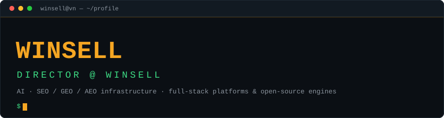
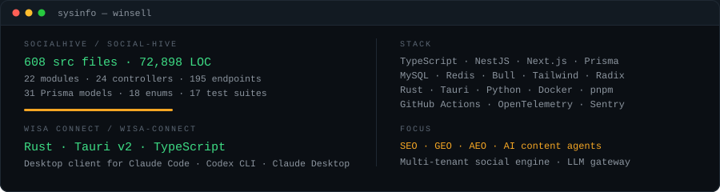
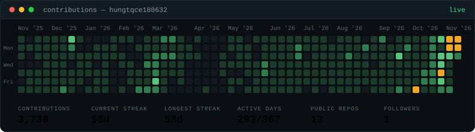

<p align="center">
  
</p>

<p align="center">
  <a href="https://winsell.vn"></a>
  <a href="https://wisa.vn"></a>
  <a href="https://github.com/winsell-vn"></a>
  <a href="https://github.com/winsell-vn/social-hive"></a>
  <a href="https://github.com/winsell-vn/wisa-connect"></a>
</p>

<p align="center"><b>Director @ WinSell</b> — building AI and SEO/GEO/AEO infrastructure, and shipping it as open source.</p>

---

### // stack

<table>
<tr>
<td valign="top" width="50%">

**Product & platform**

```text
TypeScript · NestJS 11 · Next.js 16
Prisma · MySQL · Redis · Bull
Tailwind · Radix · TanStack Query
Zustand · React Hook Form · Zod
```

**AI / infra**

```text
Groq · LLM content agents
RAG · prompt routing · tool use
JSON-LD · llms.txt · sitemaps
Docker · GitHub Actions · OpenTelemetry
```

</td>
<td valign="top" width="50%">

**Systems**

```text
Rust · Tauri v2 · React
Vitest · Jest · Playwright
pnpm · Cargo · GitHub Actions
Windows · Linux · VPS
```

**Domains**

```text
SEO · GEO · AEO
UGC content engines
Multi-tenant SaaS
Gateway & desktop clients
```

</td>
</tr>
</table>

---

### // shipped

**[`social-hive`](https://github.com/winsell-vn/social-hive)** — full-stack SEO/GEO/AEO social content engine.
NestJS + Next.js + Prisma. AI content agents, post-to-blog sync, JSON-LD, `llms.txt`, admin control plane.
*608 source files · 72,898 LOC · 195 endpoints · 31 Prisma models · MIT*

**[`wisa-connect`](https://github.com/winsell-vn/wisa-connect)** — desktop client for the WISA gateway.
Sign in with Google, AI clients are wired to the gateway. No terminal required.
*Rust · Tauri v2 · TypeScript · MIT*

**[`trivia`](../../../trivia)** — clinic platform monorepo: Expo patient app, Express + Prisma API, React admin console, Docker/Caddy deploy stack.

**[`BotCrawlSEO`](../../../BotCrawlSEO)** — Python SEO analyser: TF-IDF keyword extraction, backlink crawl, meta/heading/image audit, actionable reports.

---

### // telemetry

<p align="center">
  
</p>

<p align="center">
  
</p>

---

### // contact

```text
web     https://winsell.vn
org     https://github.com/winsell-vn
mail    contact@winsell.vn
loc     Can Tho, Vietnam
```

<p align="center">
  <sub>Built in <code>Can Tho</code>. Maintained by <a href="https://github.com/winsell-vn">WinSell</a>.</sub>
</p>
